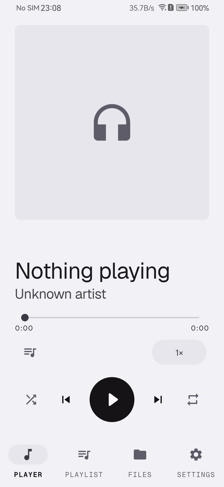
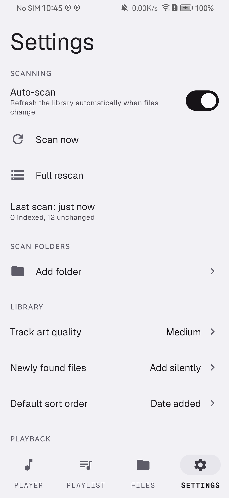

<div align="center">
  
</div>

# Audio Cat

Audio Cat is a fully offline Android audio player whose purpose is to play the **audio track of local video files** without ever decoding or rendering the video. It indexes media through MediaStore, stores the library in Room, and plays through a Media3/ExoPlayer instance that is deliberately built with no video renderer and no surface. It is a Kotlin app built with the Gradle Kotlin DSL, a View-based UI (XML + ViewBinding, Material 3), minSdk 26, compileSdk/targetSdk 36. The original specification is in [app_plan.md](app_plan.md).

## Screenshots

<div align="center">

| Player | Playlist |
|--------|----------|
|  |  |

| Files | Settings |
|-------|----------|
|  |  |

*Screenshots taken on Honor 9X (Android 10), light theme.*

</div>

## Features

The app is a single-activity shell ([MainActivity.kt](app/src/main/java/com/audiocat/MainActivity.kt)) with four fixed tabs backed by a `ViewPager2`.

### Playing

- **Playlist lane + list.** A horizontal lane of playlists sits above the track list as a fixed sibling, so the songs scroll underneath while the lane never moves. Its first card is always the whole library, so "show everything" is one tap from any playlist; tapping a card swaps the list below between `TrackDao.observeVisible()` and that playlist's saved order. Long-press a card to play all, edit tracks, rename or delete it, which is also `PlaylistDao.rename`'s only caller. The lane hides itself when there are no playlists, and the header's add button creates one.
- Transport card: play/pause, next/previous, shuffle, repeat off/all/one, and a seek bar. "Previous" restarts the current track when more than 3 seconds have elapsed, otherwise steps back.
- Now Playing bottom sheet with larger artwork, transport controls and a link to the queue ([NowPlayingSheet.kt](app/src/main/java/com/audiocat/ui/playing/NowPlayingSheet.kt)).
- Queue sheet showing the play order: tap to jump, drag handle to reorder (`ItemTouchHelper`), remove one entry, clear the queue ([QueueSheet.kt](app/src/main/java/com/audiocat/ui/playing/QueueSheet.kt)). Reordering is committed through the service so the visible list and the player's item order cannot drift.
- Search over title/artist/album; sort by date added, title, artist, duration or file size; and a filter that narrows by type (audio / video) or by container (MP3, M4A, ...), offered only from what the library actually holds. Containers key off the file extension because MediaStore's mime column is unreliable - it reports an `.m4a` as `audio/mp4a-latm` while `.mp3` rows are `audio/mpeg`, which would split one format across two keys. The header title switches to a count whenever a filter or a search is narrowing the list, so a filtered view never pretends to be the whole library.
- A library row's overflow dots and its long press both open: add to playlist, play next, unlist/relist, file info. Tapping a row starts playback and reveals the Player tab.
- Background playback through a `MediaSessionService`, so lockscreen, notification, Bluetooth and headset controls work. The queue and position are persisted to JSON across process death ([PlaybackStateStore.kt](app/src/main/java/com/audiocat/playback/PlaybackStateStore.kt)).
- Lyrics: `Track` has a `lyrics` column, populated during scan enrichment from embedded tags, but no screen currently displays them (see [Known limitations](#known-limitations)).
- Artwork: one `art_path` column names a small JPEG, and three things can fill it - a cover embedded in the file, a picture sitting next to it (`cover.jpg`, or a poster named after a downloaded video, found by [CoverFinder.kt](app/src/main/java/com/audiocat/scanner/CoverFinder.kt) through a directory listing or a media-store query), or the first frame of a video. Extraction runs during scan enrichment in [ArtworkStore.kt](app/src/main/java/com/audiocat/scanner/ArtworkStore.kt). A fourth kind is given, not found: a cover the user picks from the gallery is copied into `filesDir` (`user-…`), so deleting the original changes nothing, and no scan or cache sweep may overwrite it. Tracks with nothing to show get a designed empty plate (`@drawable/art_default`), never a blank box. Every artwork surface uses one 3dp corner, applied by [RoundArtImageView.kt](app/src/main/java/com/audiocat/ui/common/RoundArtImageView.kt) clipping its own canvas: Material's `ShapeableImageView` masks the drawable, which leaves a placeholder that carries its own colours peeking out of the rounded frame with square corners.

### Effects

> **Not reachable in the shipped navigation.** The whole surface below is implemented and unit-tested, but no tab hosts it: the bottom navigation is Player / Playlist / Files / Settings, and `EffectsFragment` has no caller. It was removed from the tabs on purpose (the player page owns speed now) and kept in the tree to be re-attached later. R8 therefore strips the UI classes from the release APK, while the effects *engine* still runs at its default (flat) settings against the player's audio session.

Live control surface in [EffectsFragment.kt](app/src/main/java/com/audiocat/ui/effects/EffectsFragment.kt); changes are pushed to the running engine immediately, with no apply step.

- **12-band equaliser UI**: one gain slider per available band, plus reset. Bands come from the platform equaliser, concatenated across up to two instances when the device exposes fewer than 12 (see [Known limitations](#known-limitations)).
- **Bass boost** (0..1) and **reverb** presets: off, small/medium/large room, medium/large hall, plate.
- **Speed** (0.25x–4x) and **pitch** (0.5x–2x) sliders, applied through ExoPlayer's `PlaybackParameters`.
- **Presets**: built-ins (Flat, Bass Boost, Treble Boost, Vocal, Loudness, Late Night) from [EffectsEngine.kt](app/src/main/java/com/audiocat/effects/EffectsEngine.kt), plus user presets saved/loaded as JSON in SharedPreferences ([EffectPresetsStore.kt](app/src/main/java/com/audiocat/ui/effects/EffectPresetsStore.kt)).
- A master "enable effects" switch that bypasses the equaliser and reverb.

### Files

[FilesFragment.kt](app/src/main/java/com/audiocat/ui/files/FilesFragment.kt) lists every scanned file, listed or unlisted, audio or video, with chip filters (All, Listed, Unlisted, Audio, Video) and a total size/count summary.

- Per file: file info (path, size, duration, MIME type, sample rate, bit rate, channels, folder), rename, unlist/relist, and "delete from device" behind an explicit confirmation.
- Multi-select: bulk unlist/relist, batch rename, bulk delete.
- **Single rename** and **batch rename** share the same planner and consent handling. The batch dialog ([BatchRenameDialog.kt](app/src/main/java/com/audiocat/ui/files/BatchRenameDialog.kt)) supports prefix, suffix, find/replace (case-sensitive option, first/all occurrences), sequential numbering (start + zero padding), and "use artist and title tags", with a live preview recomputed on every keystroke.
- **Add scan folder** through the system folder picker (`OpenDocumentTree`); the folder path is derived and added as an include entry, then a scan is triggered.

### Settings

[SettingsFragment.kt](app/src/main/java/com/audiocat/ui/settings/SettingsFragment.kt) renders from the single `AppSettings` snapshot.

- **Scanning**: auto-scan toggle, "Scan now", "Full rescan", last-scan time, add folder, and a per-folder list with an include/exclude toggle and remove. Excluded folders take precedence over included ones; an empty include list means every volume.
- **Library**: track art quality (Small/Medium/Large → 256/512/1024 px), behaviour for newly found files, default sort order.
- **Playback**: shuffle by default, repeat mode, crossfade (off / 2 s / 4 s / 8 s / 12 s), resume on headphone connect, pause on headphone disconnect.
- **Appearance**: theme follow-system / light / dark, applied through `AppCompatDelegate`.
- **Advanced**: app version, clear artwork cache, reset all settings.
- **Privacy**: an in-app note that the app is offline.

## Audio-only design

Video decoding is avoided by construction, not by convention:

1. **No video renderer.** [PlaybackService.kt](app/src/main/java/com/audiocat/playback/PlaybackService.kt) builds the player with `DefaultRenderersFactory` in its default configuration, which installs audio and text renderers only. `setExtensionRendererMode(EXTENSION_RENDERER_MODE_OFF)` keeps extension renderers out, and `setVideoEffects` is never called.
2. **No surface, ever.** The project contains no `SurfaceView`, no `TextureView` and no call to `setVideoSurface`; media items carry the track's URI (a MediaStore `content://` URI, or a `file://` URI after an in-app rename) plus metadata from the library DB, so a video container is played as an audio stream.
3. **Only the first audio track is inspected.** [TrackMetadataReader.kt](app/src/main/java/com/audiocat/scanner/TrackMetadataReader.kt) opens a `MediaExtractor`, walks the tracks and returns the format of the first track whose MIME type starts with `audio/`, releasing the extractor in a `finally` block. Video codecs are never instantiated. The scan pipeline calls it during enrichment for sample rate, bit rate and channel count.
4. **Audio-tuned buffering.** `DefaultLoadControl` uses 15 s / 60 s min/max buffers with a 500 ms start threshold, which is cheap because there is no video stream to feed. Notification metadata is supplied by the app rather than parsed by the player.

## Privacy and offline operation

The activity is locked to portrait, but the layouts must still survive a square window: the platform ignores the lock above 600dp smallest width (the foldable case) and `configChanges` means such a resize recreates nothing.

[AndroidManifest.xml](app/src/main/AndroidManifest.xml) deliberately declares **no `android.permission.INTERNET`**. Without it the platform cannot open a socket on the app's behalf, so offline operation is enforced by the OS rather than by convention. There are no analytics, ads, accounts, trials or in-app purchases. All state is local: the Room database (`audiocat.db`), SharedPreferences for settings and presets, small JPEG artwork files in the app cache, and the queue snapshot in the app's private files directory. `android:allowBackup="false"` and `fullBackupContent="false"` keep that state off cloud backups.

The manifest declares only what playback needs: `READ_MEDIA_AUDIO` / `READ_MEDIA_VIDEO` / `READ_MEDIA_IMAGES` (Android 13+ per-type grants), legacy `READ_EXTERNAL_STORAGE` (maxSdk 32) and `WRITE_EXTERNAL_STORAGE` (maxSdk 29), `POST_NOTIFICATIONS`, `FOREGROUND_SERVICE`, `FOREGROUND_SERVICE_MEDIA_PLAYBACK`, `WAKE_LOCK` and `MODIFY_AUDIO_SETTINGS`. Images are included because cover art usually sits next to the audio rather than inside it, and a phone will not let an app list a folder it does not own. Media3 merges in `ACCESS_NETWORK_STATE`, which only reads connectivity state; it grants no socket, and `INTERNET` remains absent.

## Building

Prerequisites: JDK 17, an Android SDK with platform 36 and build-tools 36.0.0, and a `local.properties` that points at that SDK, for example:

```properties
sdk.dir=/path/to/Android/Sdk
```

Then, from the project root:

```bash
export JAVA_HOME=/usr/lib/jvm/java-17-openjdk
export GRADLE_USER_HOME="$PWD/.gradle-home"
./scripts/make-keystore.sh      # once, creates keystore/audiocat.jks
./gradlew :app:assembleDebug
./gradlew :app:assembleRelease
./gradlew :app:testDebugUnitTest
```

- `GRADLE_USER_HOME` is pointed at a project-local directory on purpose, so builds do not depend on a writable `~/.gradle` or `~/.android`.
- [make-keystore.sh](scripts/make-keystore.sh) generates `keystore/audiocat.jks` and `keystore/keystore.properties` inside the project. Both debug and release builds reuse that key, so a locally built release APK stays installable. If the keystore is absent, [app/build.gradle.kts](app/build.gradle.kts) simply configures no signing config.
- Release builds enable R8 minification and resource shrinking with `proguard-rules.pro`; debug builds get the `.debug` application-id suffix and no minification.
- [gradle.properties](gradle.properties) enables the configuration cache, parallel execution and caching, and runs the Kotlin compiler in-process.
- Room schemas are exported through KSP to `app/schemas` (`room.schemaLocation`), with `room.generateKotlin=true`.

## Architecture

```
app/src/main/java/com/audiocat/
├── AudioCatApp.kt      Manual dependency container (settings, DB, scanner, file ops)
├── MainActivity.kt     Four-page pager, bottom navigation, mini player, permissions
├── data/               SettingsStore + AppSettings; data/db holds Room entities and DAOs
├── scanner/            MediaStore query, ScanPlanner, ScanCoordinator, metadata, artwork cache
├── playback/           PlaybackService (MediaSessionService), queue model, controller bridge
├── effects/            EffectsEngine: platform equaliser, bass boost, reverb
├── files/              RenamePlanner (pure) and FileOperations (disk + MediaStore)
├── ui/common/          ArtworkLoader, Formatters, ThemeController
├── ui/playing/         Playing screen, now-playing/queue/playlist sheets, list adapters
├── ui/effects/         Effects screen, band and preset adapters, preset storage
├── ui/files/           Files screen, selection, batch-rename dialog, RenameRunner
└── ui/settings/        Settings screen and scan-folder adapter
```

The playback service is the single owner of the queue and of every audio effect. The UI reaches transport controls and session state through a `MediaController` wrapped by [PlayerConnection.kt](app/src/main/java/com/audiocat/playback/PlayerConnection.kt); the parts the session protocol does not model — the equaliser and drag-to-reorder queue — go through the service's local binder ([PlaybackService.kt](app/src/main/java/com/audiocat/playback/PlaybackService.kt), `ACTION_LOCAL_BIND`). `ScanCoordinator` is the single owner of scanning, guarded by a mutex so auto-scan and manual scan cannot run concurrently.

## Testing and verification

The test sources live in [app/src/test](app/src/test):

- [QueueEngineTest.kt](app/src/test/java/com/audiocat/playback/QueueEngineTest.kt) — pure JVM tests for queue arithmetic: replace/start-index clamping, next/previous, repeat and shuffle behaviour, play-next insertion, removal cursor fix-ups, drag-move cursor tracking, and the shuffled permutation.
- [ScanPlannerTest.kt](app/src/test/java/com/audiocat/scanner/ScanPlannerTest.kt) — pure JVM tests for extension classification, path-segment containment (so `/Music/Live` never matches `/Music/LiveBootlegs`), include/exclude precedence, ignored system folders, and incremental planning by size and modification time.
- [RenamePlannerTest.kt](app/src/test/java/com/audiocat/files/RenamePlannerTest.kt) — pure JVM tests for filename sanitising, prefix/suffix, find/replace (case and first-only), sequential numbering, tag-based names, collision resolution, swapped names, and plan validation.
- [LibraryDatabaseTest.kt](app/src/test/java/com/audiocat/data/db/LibraryDatabaseTest.kt) — Robolectric tests against a real in-memory Room/SQLite database: upsert by path, unlisted filtering, search, playlist ordering/append/compaction/reorder, foreign-key cascades, track re-keying with membership preservation, scan folders, sort resolution, and the enrichment backlog (pending queue, non-clearing `applyEnrichment`, full-rescan re-queue).
- [PlaybackStateStoreTest.kt](app/src/test/java/com/audiocat/playback/PlaybackStateStoreTest.kt) — queue snapshot JSON round-trip, corrupt-file degradation, and clearing.
- [EffectPresetsStoreTest.kt](app/src/test/java/com/audiocat/ui/effects/EffectPresetsStoreTest.kt) — custom preset persistence: round-trip, replace-by-name, built-in deletion refusal, ordering.

120 tests in total. Run them with `./gradlew :app:testDebugUnitTest`, or run the whole gate with `./scripts/verify.sh` (compile, tests, lint, APKs + size budget, offline-manifest assertion, detekt). The test task redirects Robolectric's `user.home` and Maven repo into `~/.audiocat-testhome` (see [app/build.gradle.kts](app/build.gradle.kts)): Robolectric URL-encodes spaces in the repo path and then cannot read its own cached `android-all` jar, so that directory must never be placed under a path containing spaces.

[Detekt](app/detekt-baseline.xml) runs over `src/main/java` and `src/test/java` with default rules on top of a committed baseline, so it gates *new* code smells rather than re-litigating the tree. Regenerate the baseline deliberately with `./gradlew :app:detektBaseline` when refactoring.

### Verification status

- The tree compiles; all 120 JVM/Robolectric tests pass on macOS (JDK 17); `lintDebug` reports zero error-severity findings; debug and release APKs assemble (release APK 2.7 MB, minified with R8) and the merged release manifest confirms no `android.permission.INTERNET`.
- **Verified on a real phone (Honor 9X, Android 10/EMUI):** first scan indexes MediaStore audio + video containers, enrichment extracts embedded artwork, tapping a row plays real audio through the notification/lockscreen session, pause and queue restore across process death work, and all four tabs render. This pass caught three device-only bugs the JVM suite could not: a missing `LayoutManager` on the library list, a bottom-nav mapping that never moved the pager, and millihertz EQ labels.
- **Verified on the release build (minified + resource-shrunk), on the same phone:** it installs, all four tabs render with real data, tap-to-play reaches `state=PLAYING` with the app owning the audio focus, artist and album come through from the audio collection, a gallery image can be attached as a cover and survives the gallery file being deleted, and removing that cover falls back cleanly. This pass caught a crash the debug build never showed: the scan-finished callback was delivered on the scan's worker thread, so the release build threw `IllegalStateException` (media controller off the main thread) the moment a custom cover was removed.
- **Still unverified on-device:** the Android 11+ scoped-storage rename consent dialog (the test phone runs Android 10, where legacy storage applies), Bluetooth headset buttons, and effect behaviour on other vendors' decoder stacks.
- [robolectric.properties](app/src/test/resources/robolectric.properties) pins `sdk=35` because Robolectric does not yet support API 36.

## Known limitations

- **Equaliser band count and Q.** Android's platform `Equalizer` exposes a device-dependent, fixed number of bands (commonly five). When that count is below `TARGET_BANDS` (12), [EffectsEngine.kt](app/src/main/java/com/audiocat/effects/EffectsEngine.kt) probes a second `Equalizer` on the same audio session and keeps it only if it contributes genuinely new centre frequencies; on devices where a second instance repeats the same bands (verified on the Honor 9X test phone, which exposes five bands) the UI honestly shows the native count. Platform bands are fixed-Q peaking filters, so the per-band "Q" is the nominal constant `1.41`, not a user-adjustable value; gains are clamped to −15..+15 dB. `getCenterFreq`/`getBandFreqRange` report millihertz and are converted to hertz for display.
- **Crossfade is a volume fade, not a true crossfade.** ExoPlayer cannot overlap two decoders, so the code cannot cross-fade two tracks. When crossfade is enabled, the service ramps volume in over 10 steps when a track reaches `STATE_READY` and ramps out before a manual pause (`pauseWithFade`), then restores full volume. There is no overlap between consecutive tracks.
- **Pitch and speed** are ExoPlayer `PlaybackParameters`, enabled with `setEnableAudioTrackPlaybackParams(true)` and `setEnableAudioOutputPlaybackParameters(true)`. Saved `EffectPreset`s carry speed/pitch fields, but `applyPreset` applies only band gains, bass and reverb.
- **Data identity is the file path.** `Track` is keyed by `path` ([Track.kt](app/src/main/java/com/audiocat/data/db/Track.kt)). A rename re-keys the row inside one transaction: [FileOperations.kt](app/src/main/java/com/audiocat/files/FileOperations.kt) captures playlist memberships, deletes the old row (which cascades into `playlist_tracks`), inserts the row under the new path, and restores the memberships. Batch renames are applied in two phases (every file to a unique temporary name, then to its final name) to avoid ordering hazards, and are validated against the real directory listing first.
- **Scoped storage consent.** On Android 11+ a rename of public media can be refused; the operation throws `WriteConsentRequired` with a `MediaStore.createWriteRequest` `IntentSender`, and `RenameRunner` in [BatchRenameDialog.kt](app/src/main/java/com/audiocat/ui/files/BatchRenameDialog.kt) launches the one-time prompt and retries the plan on approval.
- **Scan enrichment is a budgeted backlog.** `LibraryScanner.scan()` indexes rows from MediaStore columns first, then drains an enrichment backlog capped at 300 files per run (`ScanResult.enriched`); "Full refresh" ignores the cap and re-reads every file, which is the only way a user gets a definitive answer. Each file gets `ArtworkStore.ensure` (embedded cover, a picture next to it, or a first video frame as a lazy fallback), `TrackMetadataReader` audio-stream fields and embedded lyrics, written through `TrackDao.applyEnrichment`, which never clears already-stored values and never overwrites a cover the user chose. The `enrichment_attempted` column makes it idempotent: files that genuinely have no cover art are not re-read on every scan, while rows whose cached thumbnail vanished with the cache are queued again. Note that lyrics are read into the `lyrics` column but no screen displays them yet.
- **Two stored settings have no consumer.** `watchFolders` and `dynamicColour` are persisted in [SettingsStore.kt](app/src/main/java/com/audiocat/data/SettingsStore.kt) and read by nothing; `dynamicColour` is also not exposed in the Settings UI. The others in that file do have live consumers: `newFileBehaviour` drives `NewFilePolicy` at index time, `resumeOnHeadphones` gates the reconnect-and-play path in [PlaybackService.kt](app/src/main/java/com/audiocat/playback/PlaybackService.kt), and `pauseOnHeadphonesDisconnect` gates the app's own `BECOMING_NOISY` receiver - though the player's `setHandleAudioBecomingNoisy(true)` also pauses on unplug independently of that toggle, so switching it off does not keep audio playing through a pull. The auto-scan interval (default 15 minutes) is consumed but has no UI. Playback state is restored paused, by design, to avoid surprising the user and to respect background-start limits.
- **Schema resets.** The Room database is at version 3 and uses `fallbackToDestructiveMigration(dropAllTables = true)`, which is safe only because the app has not shipped.

## Roadmap

The following are listed in the "Future Enhancements" section of [app_plan.md](app_plan.md) and are **not implemented**:

- Sleep timer.
- Export extracted audio as standalone files (opt-in).
- Lyrics import/sync UI.
- Home-screen widget.
- More theme options.
